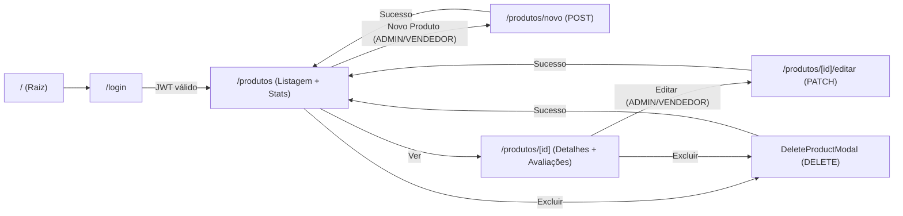

# Documentação Técnica — Marketplace (DAW III - Projeto I)

## 1. Tema e Regras de Negócio

O sistema consiste em uma plataforma de **Marketplace (E-commerce)** voltada ao gerenciamento de catálogo de **Produtos**, estruturada em torno de três perfis de acesso autenticados via **JWT (`Role`)**: **`ADMIN`**, **`VENDEDOR`** e **`CLIENTE`**.

### Principais Regras de Negócio e Validações
1. **Controle de Acesso por Perfil (`RBAC`):**
   - **Rotas Públicas:** Autenticação (`POST /auth/login`), auto-cadastro de clientes (`POST /clientes`) e de vendedores (`POST /vendedores`).
   - **Consulta (`GET`):** Qualquer usuário autenticado (`ADMIN`, `VENDEDOR` ou `CLIENTE`) pode listar, filtrar e visualizar detalhes de produtos, categorias, vendedores e avaliações.
   - **Gestão de Catálogo (`POST`, `PATCH`, `DELETE`):** Restrita a `ADMIN` e `VENDEDOR`. Clientes autenticados visualizam o catálogo sem ações de criação, edição ou exclusão, sendo redirecionados caso tentem acessar `/produtos/novo` ou `/produtos/[id]/editar`.
2. **Vínculo de Propriedade do Vendedor:**
   - Ao cadastrar ou editar um produto como `VENDEDOR`, o back-end associa automaticamente o produto ao ID extraído do token JWT (o campo `idVendedor` é omitido no front-end). Apenas o vendedor proprietário ou um `ADMIN` pode alterar ou excluir o produto (caso contrário, a API retorna `403 ACESSO_NEGADO`).
   - Quando logado como `ADMIN`, a seleção de `idVendedor` torna-se obrigatória no formulário.
3. **Integridade de Preço, Estoque e Busca:**
   - O produto exige `nome` (até 150 caracteres), `preco > 0`, `estoque >= 0` (inteiro) e `idCategoria` existente. A `descricao` é opcional (até 500 caracteres).
   - Na busca filtrada (`GET /produtos/buscar`), o intervalo de preço valida que `precoMin <= precoMax` tanto no cliente quanto no servidor.
4. **Integridade Referencial na Exclusão (`409 CONFLITO`):**
   - Produtos que já possuem vínculo com pedidos ou itens de pedido não podem ser excluídos. O front-end intercepta o retorno `409` no formato **RFC 7807 (`ProblemDetail`)** e apresenta o motivo detalhado (`detail`) ao usuário via notificação Toast.

---

## 2. Modelo de Dados

Os contratos TypeScript em `src/types/` refletem fielmente os DTOs e entidades JPA do back-end (IDs numéricos sequenciais `Long`, valores monetários decimais e datas em ISO-8601):

| Entidade / Contrato | Principais Atributos | Relacionamentos e Papel no Front-end |
|---|---|---|
| **`Produto`** (`Produto`, `ProdutoRequest`) | `id`, `nome` (≤150), `descricao` (≤500), `preco` (`number > 0`), `estoque` (`int ≥ 0`), `idCategoria`, `nomeCategoria`, `idVendedor`, `nomeVendedor` | Entidade central do CRUD (`N:1` com `Categoria` e `N:1` com `Vendedor`). |
| **`Categoria`** (`Categoria`, `CategoriaRequest`) | `id`, `nome` (≤50, único), `descricao` (≤350) | Classificação dos produtos (`1:N`). Carregada em `Select` de filtros e formulários; permite criação rápida via modal (`POST /categorias`). |
| **`Vendedor`** (`Vendedor`, `VendedorRequest`) | `id`, `nome` (≤100), `razaoSocial` (≤150), `cnpjCpf` (≤18, único), `email` (≤100, único) | Responsável pela oferta do produto (`1:N`). Selecionável pelo `ADMIN` na criação/edição de produtos. |
| **`Avaliacao`** (`Avaliacao`, `AvaliacaoRequest`) | `id`, `nota` (`1` a `5`), `comentario` (≤350), `dataAvaliacao` (ISO), `idCliente`, `nomeCliente`, `idProduto`, `nomeProduto` | Opinião de clientes sobre produtos de pedidos confirmados (`N:1` com `Produto` e `Cliente`). Exibida na página de detalhes `/produtos/[id]`. |
| **`Page<T>`** e **`ProblemDetail`** | `content`, `totalElements`, `totalPages`, `number`, `size`, `first`, `last` / `type`, `title`, `status`, `detail`, `erros` | Envelopes padronizados do Spring Boot para paginação (tamanho fixo de 10 itens) e tratamento estruturado de erros HTTP. |

---

## 3. Justificativa Técnica da Persistência e Arquitetura

### 3.1. Persistência Real via API REST (Spring Boot + PostgreSQL)
Em vez de armazenamento volátil ou mocks locais, o projeto utiliza **integração real com o back-end Spring Boot 4 e banco relacional PostgreSQL 16** (executado em container Docker). Essa escolha garante:
- **Consistência transacional e validação em duas pontas:** As regras de domínio são validadas preventivamente no front-end com **Zod + React Hook Form** e asseguradas definitivamente pelo **Bean Validation / Hibernate** no servidor.
- **Segurança Stateless com JWT:** A sessão (`token`, `email`, `role`) é gerenciada pelo `AuthContext` (`useSyncExternalStore` sincronizado ao `localStorage`) e injetada automaticamente no header `Authorization: Bearer <token>` pelo cliente central `src/services/api.ts`.
- **Solução transparente de CORS:** O `next.config.ts` configura `rewrites` redirecionando `/api/:path*` para `http://localhost:8080/:path*`, permitindo chamadas relativas seguras sem acoplamento de domínio no código-fonte.

### 3.2. Arquitetura em Camadas no Front-end
O código foi dividido em `types/`, `services/`, `context/`, `components/` e `app/`. Nenhum componente visual invoca `fetch` diretamente: toda comunicação passa por serviços tipados (`produtoService`, `categoriaService`, `vendedorService`, `avaliacaoService`, `authService`, `seedService`) que convertem falhas HTTP em instâncias de `ApiError` contendo o `ProblemDetail` do Spring Boot.

---

## 4. Fluxo das Telas e Navegação

1. **Autenticação (`/login`):** Permite login com validação, criação rápida de conta (`Cliente` ou `Vendedor`) e botões de **Preenchimento Rápido (Demo)** para testar imediatamente os perfis `ADMIN` e `VENDEDOR`.
2. **Listagem, Estatísticas e Exportação (`/produtos`):** Exibe o cabeçalho global (com botão de **Seed** para `ADMIN` e alternador de tema), 4 cards de indicadores (`ProductStats`), barra de filtros combinados (`GET /produtos/buscar`) com ordenação em memória, tabela/cards responsivos, exportação para `.CSV`/`.JSON` e paginação.
3. **Criação (`/produtos/novo`) e Edição (`/produtos/[id]/editar`):** Reutilizam o `ProductForm`, oferecendo criação rápida de categoria em modal (`CategoriaQuickDialog`) sem perder o preenchimento do produto e enviando `POST` ou `PATCH` conforme a rota.
4. **Detalhes e Exclusão (`/produtos/[id]`):** Apresenta ficha completa do produto, status de estoque, vendedor responsável, lista de avaliações com média de estrelas e acionamento do `DeleteProductModal` com confirmação e tratamento amigável de erros `409`.
