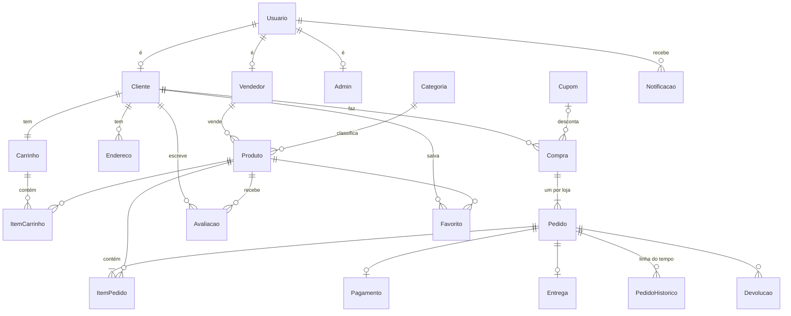
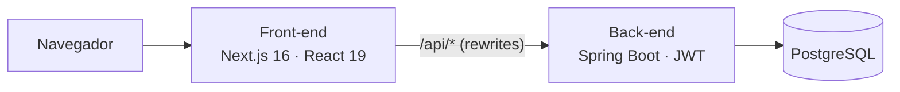
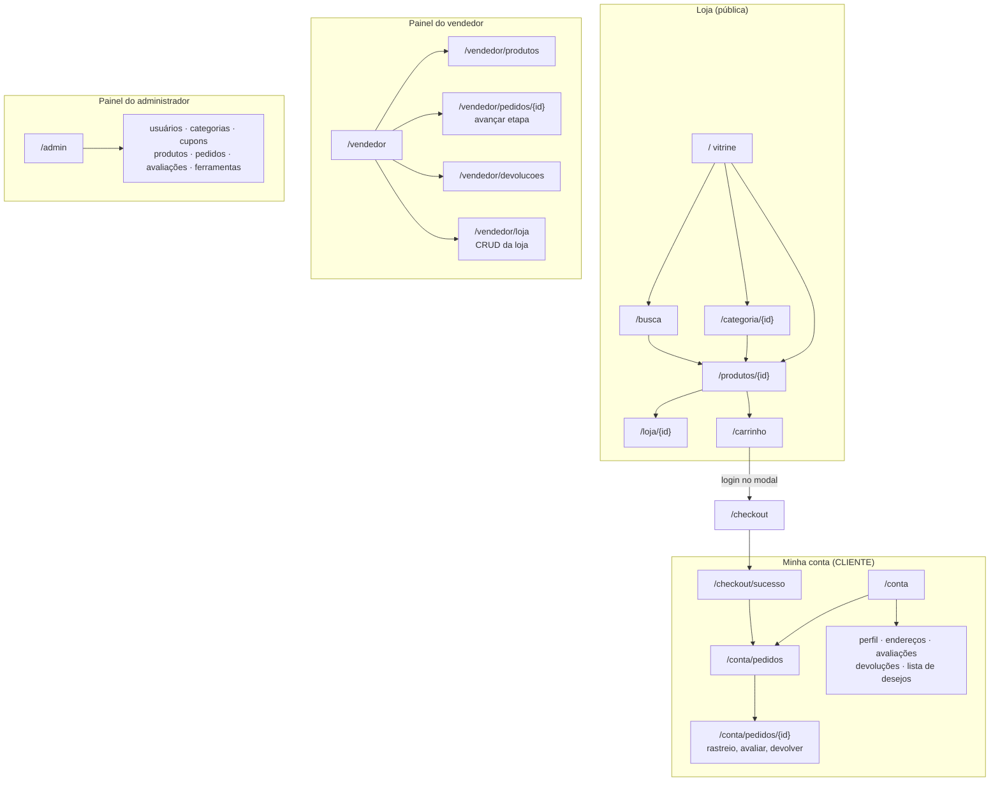
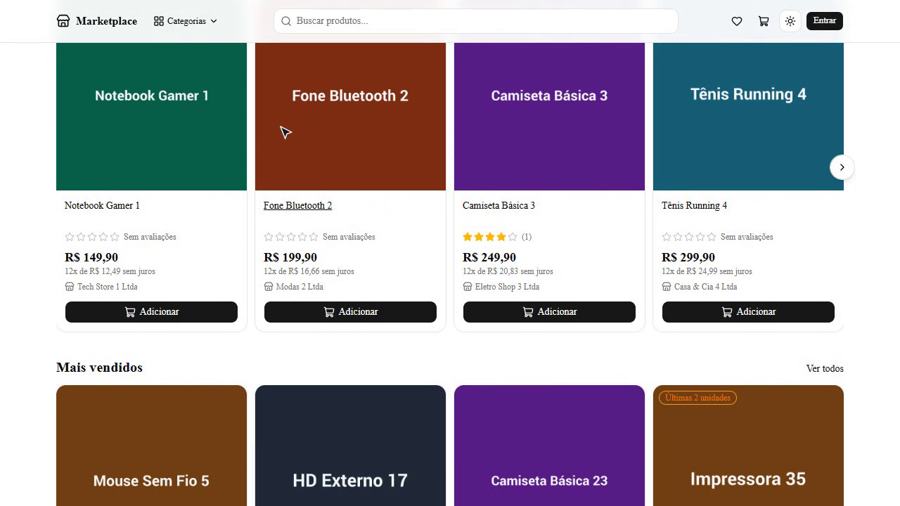
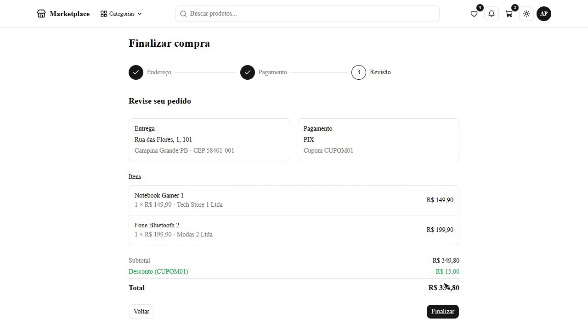
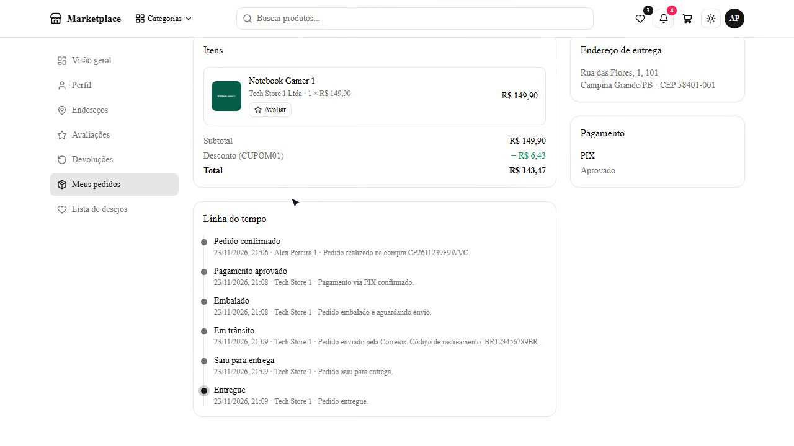
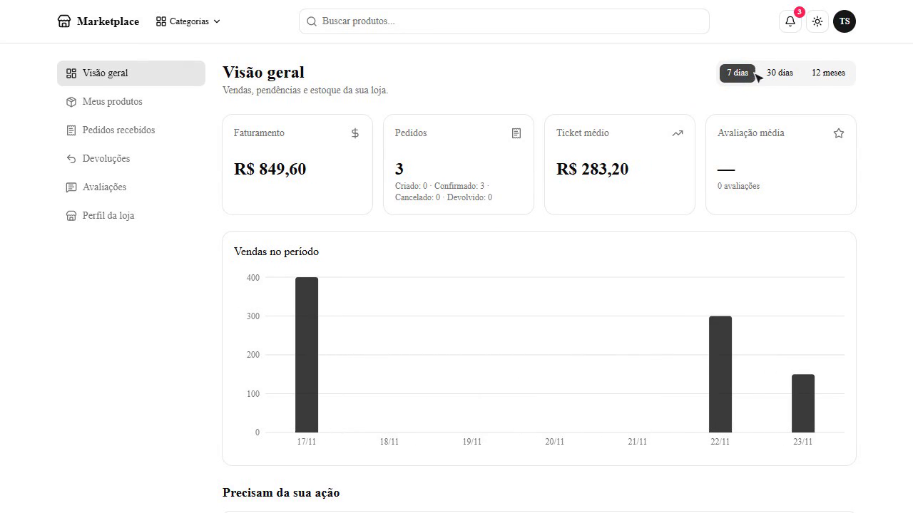
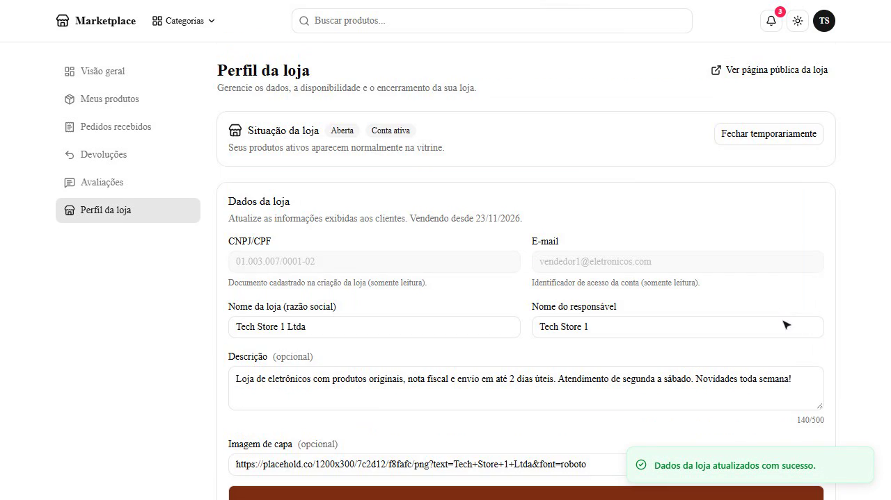
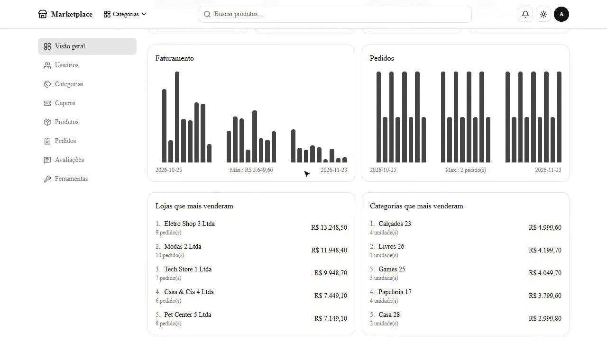

# Documentação Técnica — Marketplace (DAW III)

- **Instituição:** IFPB — Campus Esperança (CST em Análise e Desenvolvimento de Sistemas)
- **Disciplina:** Desenvolvimento de Aplicações Web III — Prof. André Atanasio
- **Equipe:** João Victor de Lucena Silva, Lucas Barbosa Graciano, Paulo Moura Menezes e Valdenio Pantaleao dos Santos
- **Back-end (API Spring Boot):** [devlucas-tec/DAW2-PROJETO](https://github.com/devlucas-tec/DAW2-PROJETO)
- **Vídeo de demonstração:** [youtu.be/e2L_eYKAVTQ](https://youtu.be/e2L_eYKAVTQ)

---

## 1. Tema e regras de negócio

Marketplace com vários vendedores. Cada loja (um `Vendedor`) cadastra os próprios produtos; o cliente monta um carrinho com produtos de várias lojas e paga uma vez só. Há quatro formas de acesso: visitante (sem login), `CLIENTE`, `VENDEDOR` e `ADMIN`, com autenticação por JWT.

### Principais regras
1. **Navegação anônima:** vitrine, busca, categoria, produto, página da loja e carrinho funcionam sem login. O login é pedido só no checkout (modal), e o carrinho do visitante, guardado no navegador, é juntado ao da conta.
2. **Uma compra, um pedido por loja:** o checkout gera uma `Compra` e um `Pedido` para cada vendedor dos itens. O cupom é distribuído entre os pedidos na proporção do valor.
3. **Endereço congelado no pedido:** o endereço de entrega é copiado para o pedido (`EnderecoEntrega`); alterar ou apagar o endereço do cliente depois não muda pedidos antigos.
4. **Ciclo do pedido controlado pelo vendedor:** confirmado → pagamento aprovado → embalado → em trânsito (transportadora e código de rastreio obrigatórios) → saiu para entrega → entregue. A API recusa saltos de etapa (`422`) e cada passo vira uma linha do `PedidoHistorico`, com data e autor.
5. **Cancelamento:** só antes do envio; devolve o estoque e estorna o pagamento aprovado.
6. **Avaliação:** só para quem recebeu o produto (pedido entregue) e uma vez por produto.
7. **Devolução:** só de pedido entregue, com motivo. Aprovar devolve o estoque, estorna o pagamento e muda o pedido para `DEVOLVIDO`; recusar permite uma nova solicitação.
8. **Propriedade:** o vendedor só vê e altera os próprios produtos, pedidos, devoluções e a própria loja (`403` para os de outra loja). O `idVendedor` vindo no corpo é ignorado: vale o do token.
9. **Loja:** pode ser fechada temporariamente (os produtos saem da vitrine) ou excluída com confirmação de senha; com pedidos em andamento, a exclusão é bloqueada.
10. **Vitrine:** esconde produtos pausados, sem estoque (por padrão), de lojas fechadas e de vendedores bloqueados. A ordenação da busca é feita no servidor e vale para o catálogo inteiro.

---

## 2. Modelo de dados

| Entidade | Principais atributos | Observações |
|---|---|---|
| `Produto` | `nome`, `descricao`, `preco`, `estoque`, `imagemUrl`, `imagens` (galeria), `ativo`, `mediaAvaliacoes`, `totalAvaliacoes`, `dataCadastro` | `ativo = false` pausa o anúncio sem excluir. |
| `Vendedor` (a loja) | `nome`, `razaoSocial`, `cnpjCpf`, `email`, `descricao`, `bannerUrl`, `lojaAberta` | O perfil público não expõe CNPJ/CPF nem e-mail. |
| `Compra` | `codigo`, `dataCompra`, `metodoPagamento`, `valorSubtotal`, `valorDesconto`, `valorTotal`, `cupom` | Agrupa os pedidos de um mesmo checkout. |
| `Pedido` | `dataPedido`, `status`, `valorTotal`, `valorDesconto`, `enderecoEntrega` | `enderecoEntrega` (rua, número, complemento, CEP, cidade, estado) é uma cópia embutida. A API também devolve `etapaAtual`, `proximaEtapa` e a última devolução. |
| `PedidoHistorico` | `etapa`, `data`, `descricao`, `nomeAutor`, `papelAutor` | Alimenta a linha do tempo do cliente e do vendedor. |
| `Pagamento` | `metodo`, `status` (pendente, aprovado, recusado, estornado), `valorPago` | |
| `Entrega` | `transportadora`, `codigoRastreamento`, `statusEntrega`, `dataEnvio`, `dataEntregaPrevista`, `dataEntrega` | |
| `Devolucao` | `motivo`, `status` (pendente, aprovada, recusada), `dataDevolucao` | |
| `Avaliacao` | `nota` (1 a 5), `comentario`, `dataAvaliacao` | |
| `Carrinho` / `ItemCarrinho` | `quantidade` por produto | O carrinho do visitante fica no navegador até o login. |
| `Endereco`, `Cupom`, `Favorito`, `Notificacao` | | Endereços do cliente, cupons de valor fixo, lista de desejos e avisos de mudança de status. |

---

## 3. Arquitetura

- **Camadas no front-end:** `app/` (rotas), `components/` (telas por área), `context/` (sessão, carrinho, modal, favoritos, notificações), `services/` (única camada que chama a API) e `types/` (contratos dos DTOs). Nenhum componente usa `fetch` direto: `services/api.ts` injeta o token, normaliza a paginação e converte erros `ProblemDetail` (RFC 7807) em `ApiError`.
- **Sessão:** guardada no `localStorage` e lida com `useSyncExternalStore`. Telas que dependem dela esperam o `ready` para não divergir do HTML do servidor.
- **Páginas:** cada página com sessão segue `page.tsx` (servidor, com `metadata`) + `conteudo.tsx` (cliente). Erros e carregamento ficam em `error.tsx`, `not-found.tsx` e `loading.tsx`.
- **Proxy:** `/api/*` é encaminhado ao back-end pelo `rewrites` do Next (sem CORS). O endereço vem de `BACKEND_URL`.
- **Entrega:** o GitHub Actions publica as imagens Docker do front-end e do back-end a cada merge na `main`. O `docker-compose.yml` que sobe banco, back-end e front-end é enviado à parte (não fica no repositório).

---

## 4. Navegação

---

## 5. Telas

As capturas do Projeto II estão em [`docs/prints/p2`](docs/prints/p2) e no README; as do Projeto I continuam em [`docs/prints`](docs/prints).

| | |
|---|---|
| **Vitrine**  | **Checkout**  |
| **Rastreio e linha do tempo**  | **Painel do vendedor**  |
| **Perfil da loja**  | **Painel do administrador**  |
