# Marketplace — Front-end (DAW III)

- **Instituição:** IFPB — Campus Esperança (CST em Análise e Desenvolvimento de Sistemas)
- **Disciplina:** Desenvolvimento de Aplicações Web III — Prof. André Atanasio
- **Equipe:** João Victor de Lucena Silva, Lucas Barbosa Graciano, Paulo Moura Menezes e Valdenio Pantaleao dos Santos
- **Back-end (API Spring Boot):** [devlucas-tec/DAW2-PROJETO](https://github.com/devlucas-tec/DAW2-PROJETO)
- **Documentação técnica:** [DOCUMENTACAO.md](DOCUMENTACAO.md)

Marketplace com vários vendedores: cada loja cadastra os próprios produtos e o cliente compra de várias lojas num carrinho só. O front-end é feito em **Next.js 16 (App Router) + React 19 + TypeScript**, com **Tailwind CSS v4** e **shadcn/ui**, e consome a API REST do back-end (Spring Boot + PostgreSQL + JWT).

---

## Vídeo de demonstração

[](https://youtu.be/e2L_eYKAVTQ)

**[▶ Assistir no YouTube](https://youtu.be/e2L_eYKAVTQ)** (9 min 40 s): uma compra de ponta a ponta passando pelos três perfis. O visitante monta o carrinho sem login, o cliente compra e acompanha o pedido, o vendedor despacha e responde à devolução, e o administrador acompanha as métricas. 

---

## 1. Funcionalidades por perfil

### Visitante (sem login)
- **Vitrine (`/`):** banners, atalhos de categoria e as seções Ofertas, Mais vendidos, Novidades e Lojas em destaque, todas vindas do back-end.
- **Busca (`/busca`) e categoria (`/categoria/{id}`):** filtros por categoria, faixa de preço, avaliação mínima, estoque e loja; chips removíveis; ordenação no servidor; paginação. Os filtros ficam na URL e, no celular, abrem numa gaveta.
- **Produto (`/produtos/{id}`):** galeria, parcelamento, seletor de quantidade limitado ao estoque, card da loja, avaliações com histograma e produtos relacionados.
- **Página pública da loja (`/loja/{id}`):** capa, descrição, nota média e produtos da loja.
- **Carrinho sem login:** os itens ficam no navegador. O login é pedido só para finalizar a compra, num modal, e o carrinho do visitante é juntado ao da conta.

### Cliente
- **Checkout em etapas (`/checkout`):** endereço (com preenchimento pelo CEP), pagamento (PIX, cartão ou boleto) com cupom de desconto e revisão. Cada compra gera um pedido por loja.
- **Minha conta (`/conta`):** visão geral, meus pedidos com filtro, detalhe do pedido com barra de progresso, rastreio e linha do tempo; perfil, endereços, avaliações, devoluções e lista de desejos.
- **Pós-venda:** cancelamento antes do envio, avaliação do produto depois da entrega e pedido de devolução com motivo.
- **Notificações:** sino no cabeçalho com as mudanças de status dos pedidos.

### Vendedor
- **Visão geral (`/vendedor`):** faturamento, pedidos, ticket médio e avaliação da loja, gráfico de vendas por período, pedidos que esperam ação e alertas de estoque baixo.
- **Meus produtos:** cadastro com imagem por URL, edição, edição rápida de preço, estoque e imagem, e pausar ou reativar o anúncio.
- **Pedidos recebidos:** avanço do pedido etapa por etapa (pagamento, embalado, despacho com transportadora e rastreio, saiu para entrega, entregue).
- **Devoluções e avaliações recebidas:** aprovar ou recusar devoluções (aprovar devolve o estoque e estorna o pagamento) e ver o que os clientes disseram.
- **Perfil da loja (CRUD):** ver, editar nome, razão social, descrição e capa, fechar a loja temporariamente e excluir a conta com confirmação de senha.

### Administrador
- **Visão geral (`/admin`):** GMV, pedidos, ticket médio, novos usuários, gráficos e rankings de lojas e categorias.
- **Gestão:** usuários (bloquear e desbloquear), categorias, cupons, produtos de todas as lojas, pedidos e avaliações.
- **Ferramentas:** popular, limpar ou resetar o banco com dados de demonstração.

### Para todos
Páginas de erro e de carregamento, metadata em todas as páginas, link "Pular para o conteúdo", foco visível, navegação por teclado nos modais, tema claro e escuro e layout para celular.

---

## 2. Fluxo de compra

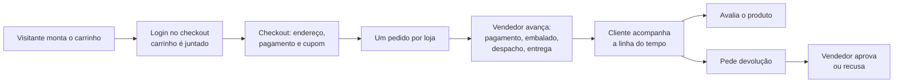

---

## 3. Rotas

| Área | Rotas |
|---|---|
| Loja (pública) | `/`, `/busca`, `/categoria/{id}`, `/produtos`, `/produtos/{id}`, `/loja/{idVendedor}`, `/carrinho`, `/login` |
| Compra (cliente) | `/checkout`, `/checkout/sucesso` |
| Minha conta (cliente) | `/conta`, `/conta/pedidos`, `/conta/pedidos/{id}`, `/conta/perfil`, `/conta/enderecos`, `/conta/avaliacoes`, `/conta/devolucoes`, `/conta/favoritos`, `/notificacoes` |
| Vendedor | `/vendedor`, `/vendedor/produtos`, `/vendedor/pedidos`, `/vendedor/pedidos/{id}`, `/vendedor/devolucoes`, `/vendedor/avaliacoes`, `/vendedor/loja`, `/produtos/novo`, `/produtos/{id}/editar` |
| Administrador | `/admin`, `/admin/usuarios`, `/admin/categorias`, `/admin/cupons`, `/admin/produtos`, `/admin/pedidos`, `/admin/avaliacoes`, `/admin/ferramentas` |

`/produto/{id}` e `/meus-pedidos` redirecionam para `/produtos/{id}` e `/conta/pedidos`.

---

## 4. Tecnologias

- **Framework:** Next.js 16.4 (App Router, Cache Components e saída `standalone`) e React 19.3
- **Linguagem:** TypeScript 5
- **Interface:** Tailwind CSS v4, shadcn/ui (`@base-ui/react`), Lucide Icons e Recharts (gráficos)
- **Formulários:** React Hook Form + Zod
- **Feedback e tema:** Sonner (toasts) e `next-themes`
- **Integração:** chamadas a `/api/*` encaminhadas ao back-end pelo `rewrites` do Next (sem CORS). O endereço do back-end vem de `BACKEND_URL` (padrão `http://localhost:8080`).
- **Entrega:** imagem Docker `devlucas07/marketplace-frontend` publicada no Docker Hub pelo GitHub Actions a cada merge na `main`

---

## 5. Como executar

### 5.1. Pré-requisitos
- Node.js 20+ e npm
- Java 17 e PostgreSQL (ou Docker) para o back-end

### 5.2. Back-end
Siga o README do [repositório do back-end](https://github.com/devlucas-tec/DAW2-PROJETO). A API sobe em `http://localhost:8080`.

### 5.3. Front-end
```bash
npm install
npm run dev
```
Acesse `http://localhost:3000`.

### 5.4. Com Docker (sem instalar Node, Java nem PostgreSQL)
As imagens do front-end (`devlucas07/marketplace-frontend`) e do back-end (`devlucas07/marketplace-backend`) ficam no Docker Hub e são atualizadas a cada merge na `main`.

O arquivo `docker-compose.yml`, que sobe o banco, o back-end e o front-end juntos, **não fica no repositório**: ele é enviado à parte pela equipe. Com ele numa pasta qualquer e o Docker instalado:

```bash
docker compose up -d
```

Depois, acesse `http://localhost:3000` (a API fica em `http://localhost:8080`). As instruções estão comentadas no próprio arquivo.

---

## 6. Credenciais de demonstração

Na tela de login, os botões de **Preenchimento rápido** preenchem estas contas:

| Perfil | E-mail | Senha | Observação |
|---|---|---|---|
| Administrador | `admin@marketplace.com` | `admin123` | Criado automaticamente no primeiro início do back-end |
| Vendedor | `vendedor1@eletronicos.com` | `senha123` | Disponível depois de popular o banco |
| Cliente | `cliente1@email.com` | `senha123` | Disponível depois de popular o banco |

Para popular o banco, entre como administrador e use **Administrador › Ferramentas › Popular banco**.

---

## 7. Telas

| | |
|---|---|
| **Vitrine**<br/>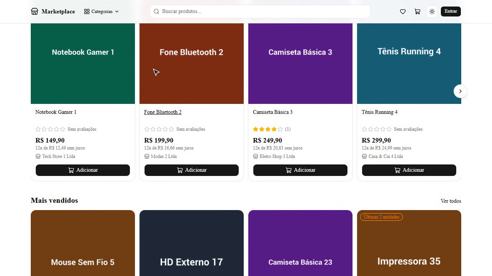 | **Busca com filtros**<br/>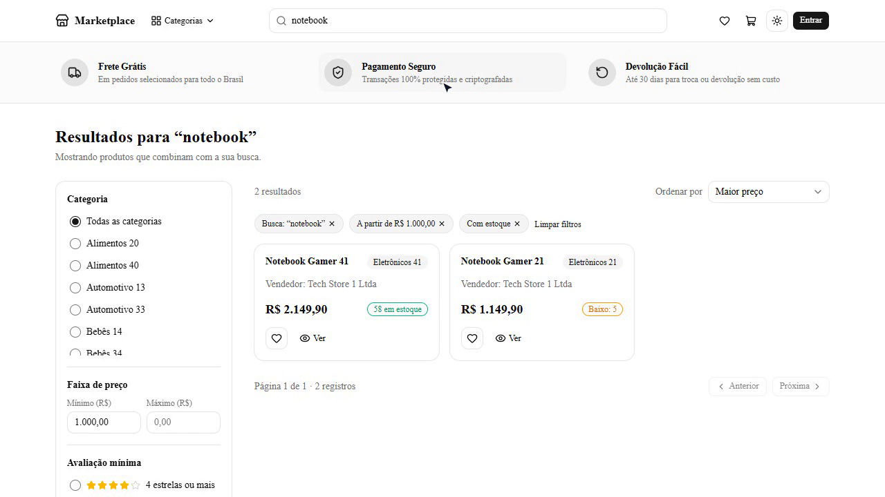 |
| **Produto**<br/>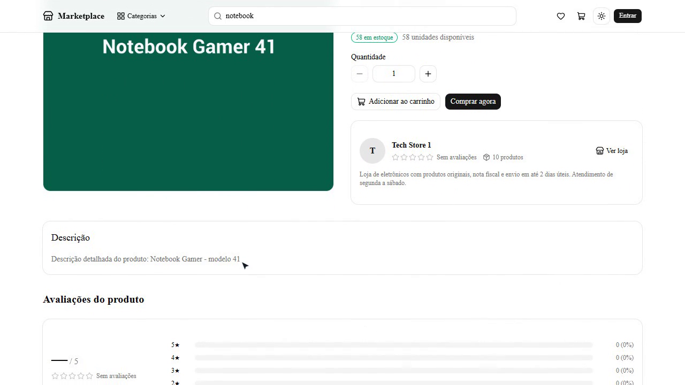 | **Carrinho do visitante**<br/>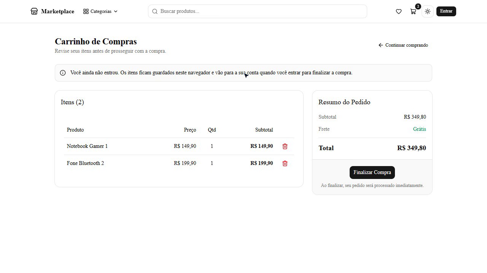 |
| **Checkout (revisão)**<br/>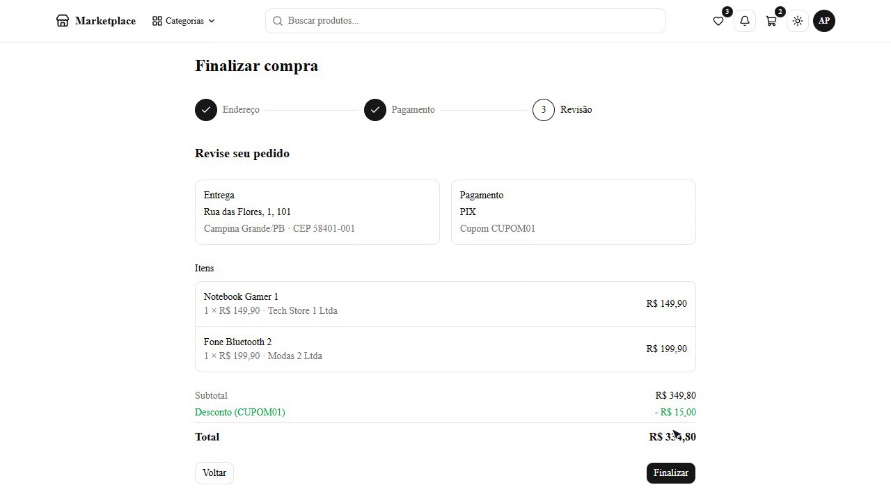 | **Meus pedidos**<br/>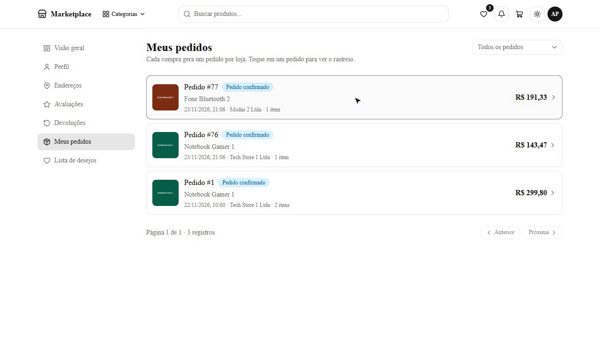 |
| **Rastreio e linha do tempo**<br/>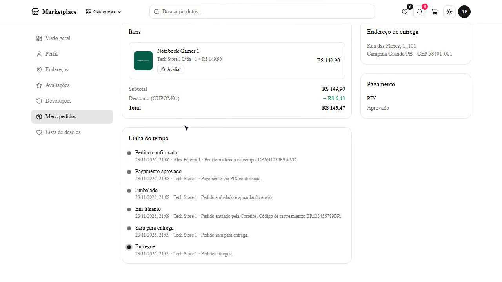 | **Pedido de devolução**<br/>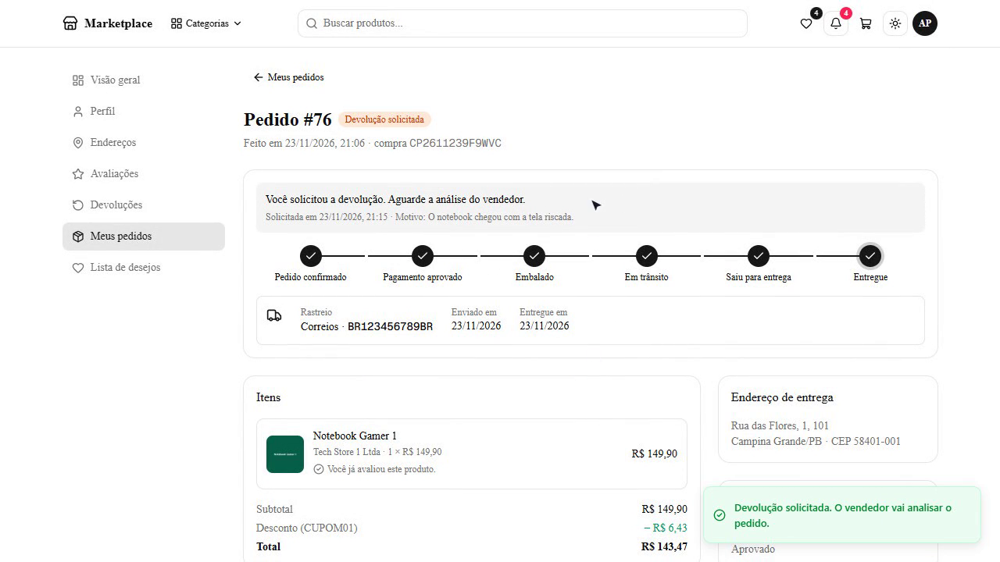 |
| **Painel do vendedor**<br/>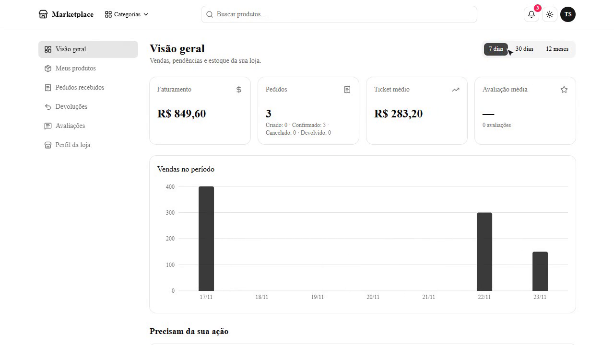 | **Vendedor avança o pedido**<br/>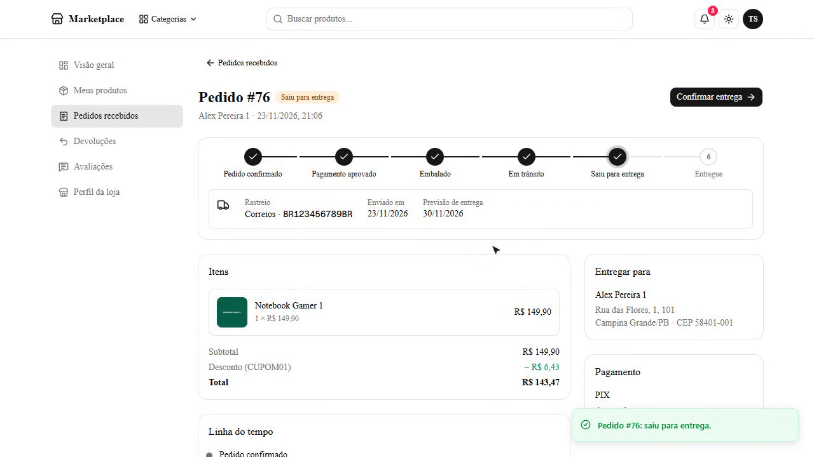 |
| **Perfil da loja**<br/>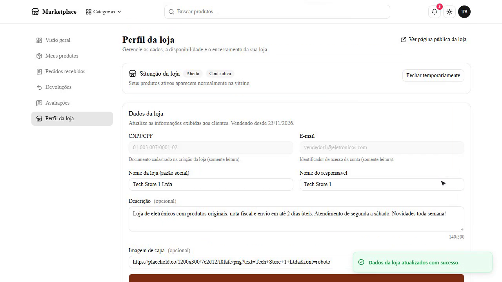 | **Painel do administrador**<br/>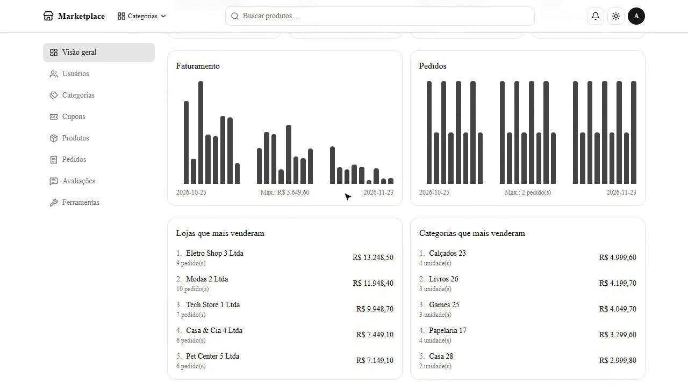 |
| **No celular**<br/>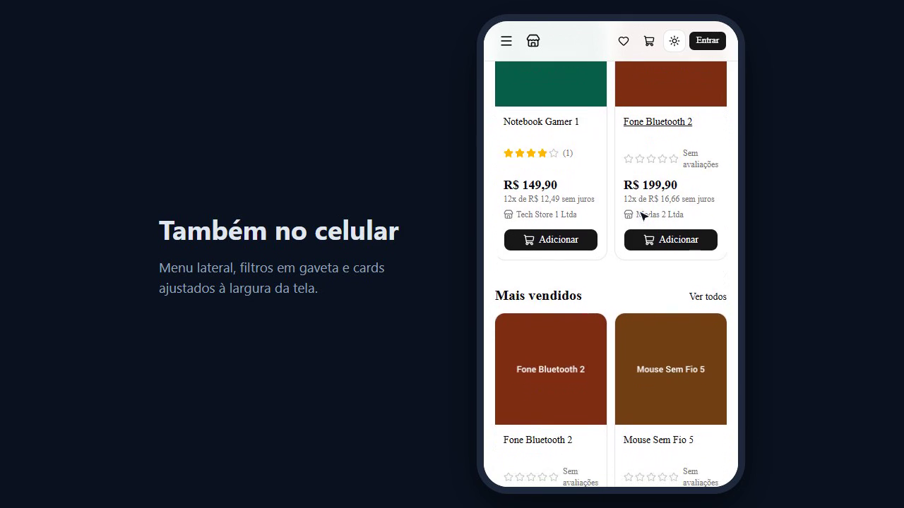 | |

---

## 8. Estrutura de pastas

```text
src/
├── app/
│   ├── (loja)/          # Vitrine, busca, categoria, produto, página da loja e área do cliente (perfil, endereços…)
│   ├── (painel)/        # Painéis com sidebar: conta do cliente, vendedor, administrador e notificações
│   ├── carrinho/        # Carrinho (visitante e cliente)
│   ├── checkout/        # Checkout em etapas e página de sucesso
│   ├── login/           # Login e cadastro
│   ├── error.tsx, not-found.tsx, loading.tsx, global-error.tsx
│   └── layout.tsx       # Providers (tema, sessão, carrinho, modal, favoritos, notificações) e metadata
├── components/          # Por área: admin, auth, busca, checkout, layout, loja, pedidos, produtos, vendedor, vitrine, ui
├── context/             # AuthContext, CartContext, ModalContext, FavoritosContext, NotificacoesContext
├── hooks/               # useCarregar, useRequireAuth, useAtualizarAoFocar…
├── lib/                 # Formatação (moeda, datas), rótulos e utilitários
├── services/            # Única camada que fala com a API (api.ts + um serviço por recurso)
└── types/               # Contratos TypeScript dos DTOs do back-end
```

Cada página com sessão segue o padrão `page.tsx` (servidor, com `metadata`) + `conteudo.tsx` (cliente).

---

## 9. Projeto I

O CRUD de produto do Projeto I continua no sistema (`/produtos`, `/produtos/novo`, `/produtos/{id}/editar`), com estatísticas do catálogo, exportação em CSV e JSON e tratamento do conflito `409` na exclusão. Os prints daquela etapa estão em [`docs/prints`](docs/prints).
